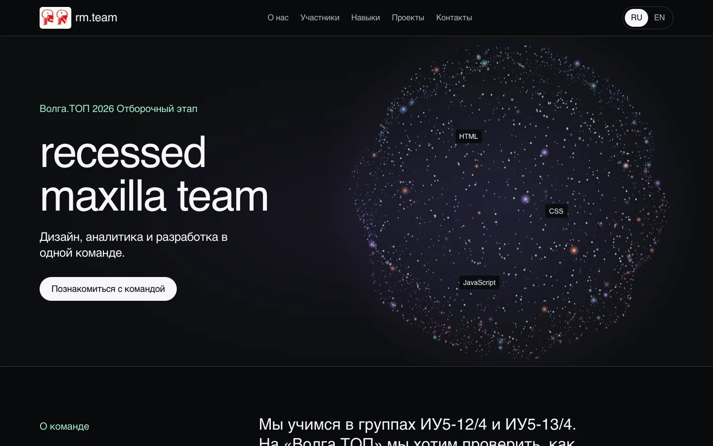
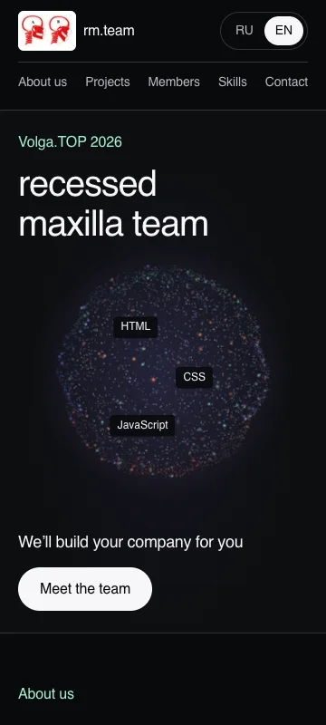

# recessed maxilla team — Team Onboarding

Двуязычная визитка команды для отборочного этапа хакатона «Волга.ТОП» 2026. На сайте представлены участники, их роли, достижения и технологии команды.

## 1. Команда

| ФИО | Учебная группа | Роль | Профиль GitVerse | Личный вклад |
| --- | --- | --- | --- | --- |
| Стукалов Артём Андреевич | ИУ5-12/4 | Designer, Technical Writer | **TODO** — добавить профиль | Подготовил README, добавил Dobropay в портфолио и исправил сборку Docker при отсутствии каталога `public`. [README](https://github.com/akkne/team-onboarding-page/pull/3) · [Портфолио](https://github.com/akkne/team-onboarding-page/pull/7) · [Docker](https://github.com/akkne/team-onboarding-page/pull/20) |
| Стёпкин Артемий Юрьевич | ИУ5-12/4 | Team Lead, Tech Lead | [akkne](https://gitverse.ru/akkne) | Реализовал двуязычную визитку и интерактивную сферу, оптимизировал отрисовку частиц и связал подписи с данными о навыках. [Визитка](https://github.com/akkne/team-onboarding-page/pull/5) · [Сфера](https://github.com/akkne/team-onboarding-page/pull/16) |
| Зеленко Артур Олегович | ИУ5-12/4 | Frontend Developer | [rtz_99999](https://gitverse.ru/rtz_99999) | Подготовил спецификацию оформления экранов и компонентов. [Изменения в документации](https://github.com/akkne/team-onboarding-page/pull/4) |
| Верховых Егор Дмитриевич | ИУ5-13/4 | CEO, Analyst | **TODO** — добавить профиль | Отвечает за аналитику и проверку README. **TODO** — указать результат работы Егора и ссылку на изменение из его учётной записи. |

**TODO** — перед сдачей проверить, что в истории репозитория на российской площадке виден вклад каждого участника из его собственной учётной записи.

## 2. Реализованное решение

Страница открывается на русском по адресу `/ru` и на английском по адресу `/en`. Корневой адрес ведёт на русскую версию. Якорное меню ведёт к разделам визитки, а переключатель RU / EN работает и при отключённом JavaScript.

Через меню можно перейти к рассказу о команде, проектам, карточкам участников, навыкам и контактам. Кнопка «Подробнее» раскрывает рассказ команды и снимок главного экрана проекта. Репозиторий открывается по отдельной ссылке. Сферу на первом экране можно вращать перетаскиванием.

Состав команды, тексты, навыки, портфолио и адрес для связи команды редактируются в [frontend/data/team.ts](frontend/data/team.ts). Для переводимых полей заполните `ru` и `en`. Чтобы опубликовать работу, добавьте в `team.projects` название, краткое описание, тип `project` или `idea`, разделы рассказа (`story`) и снимок с описанием для обеих локалей (`screenshot`). Ссылка на репозиторий необязательна. Раздел портфолио и его пункт меню появляются с первой работой. Первая работа — сама визитка. Поле `team.contact` задаёт адрес для связи в подвале; сейчас оно ведёт в GitHub Issues проекта.

Сфера на первом экране по очереди показывает названия из `team.skills`. Добавьте технологию в раздел навыков один раз, и она появится также на сфере. Названия навыков и четырёх групп (Frontend, Backend, Architecture, Infrastructure) пишите на английском для обеих версий страницы.

## 3. Технологический стек

| Часть | Технологии |
| --- | --- |
| Язык | TypeScript 5.9.3 |
| Интерфейс | Next.js 16.4.6, React 19.3.1 |
| Стили | Tailwind CSS 4.3.5, PostCSS 8.5.33 |
| Среда разработки | Node.js 22, npm |
| Проверки | ESLint, TypeScript, сборка Next.js |
| Контейнеризация | Docker, Docker Compose |
| CI | GitHub Actions |

Точные версии npm-зависимостей зафиксированы в frontend/package-lock.json.

## 4. Архитектура

Приложение использует Next.js App Router. Страница / перенаправляет посетителя на /ru. Маршруты /ru и /en генерируются статически. Макет устанавливает язык HTML-документа, а страница выбирает контент визитки по языковому сегменту адреса. Переключатель ведёт на соответствующий маршрут.

Отдельного backend-сервиса и базы данных в текущей версии нет. Для контейнерного запуска Next.js собирается в режиме standalone.

Подробнее: [архитектура](docs/architecture.md), [технологический стек](docs/tech-stack.md), [карта документации](docs/README.md).

## 5. Установка и запуск

Требуются Node.js 22, npm и Git.

Клонируйте репозиторий и запустите приложение:

```sh
git clone https://github.com/akkne/team-onboarding-page.git
cd team-onboarding-page/frontend
npm ci
npm run dev
```

Откройте [http://localhost:3000](http://localhost:3000). Корневой адрес перенаправит на русскую версию страницы.

Из каталога frontend доступны проверки и production-сборка:

```sh
npm run lint
npm run typecheck
npm run build
```

### Запуск в Docker Compose

В корне репозитория выполните:

```sh
docker compose config --quiet
docker compose up -d --build frontend
```

По умолчанию откройте [http://localhost:3000](http://localhost:3000). Для порта 3001 укажите `FRONTEND_PORT=3001` в корневом `.env` перед запуском. Для остановки контейнера выполните:

```sh
docker compose down
```

Порт контейнера доступен только локально. Дополнительные настройки приведены в [инструкции по Docker Compose](infra/README.md).

## 6. Структура репозитория

```text
.
├── .github/workflows/       # Проверки и автослияние PR
├── docs/                    # Архитектура, стек и документация проекта
├── frontend/
│   ├── app/
│   │   ├── [lang]/          # Русская и английская версии страницы
│   │   └── globals.css      # Общие стили
│   ├── components/          # Карточка участника, эмблема и сфера
│   ├── data/                # Данные команды, переводы и подписи сферы
│   ├── Dockerfile
│   ├── package.json
│   └── package-lock.json
├── infra/README.md           # Инструкция по Docker Compose
├── tests/                    # Каталог для тестов
├── compose.yaml
└── README.md
```

## 7. Использование искусственного интеллекта

| Участник | Инструмент и модель | Задача и краткое содержание запросов | Что получено | Как проверено и доработано | Файл в архиве |
| --- | --- | --- | --- | --- | --- |
| Стукалов Артём | ChatGPT Codex, GPT-6 | Сверить README с ТЗ и описать запуск проекта по файлам репозитория | Черновик README с составом команды, стеком и командами запуска | В этой сессии команды запуска не выполнялись. **TODO** — Егору указать результат редакторской проверки. | **TODO** — указать путь к экспорту сессии README |
| Стёпкин Артемий | ChatGPT Codex, GPT-6 и ImageGen | Переработать главную страницу на русском и английском, сохранить обязательные разделы, подготовить графику первого экрана | Двуязычные компоненты, стили, графика и черновики текстов | Проверены сборка, переключатель языков и навигация с клавиатуры на экранах 360, 768 и 1440 px. [Проверки редизайна](https://github.com/akkne/team-onboarding-page/pull/6) | **TODO** — указать путь к материалам сессии редизайна |

ИИ помог подготовить текст README, вёрстку и графику визитки. Артём просил описать фактический порядок запуска, Артемий — собрать обе языковые версии из общих компонентов. Черновые формулировки о команде потребовали правки. Участники предложили собственный текст о работе над проектами и знакомстве в университете, а Артемий вернул эти формулировки на сайт и обновил английский перевод. [Правка раздела «О нас»](https://github.com/akkne/team-onboarding-page/pull/28)

**TODO** — Стукалову Артёму собрать материалы сессий, удалить из них пароли, ключи доступа, персональные и конфиденциальные данные, затем добавить `ai-sessions.zip` в корень репозитория. **TODO** — после проверки архива подтвердить очистку и дать здесь ссылку на файл.

## 8. Демонстрация

| Главная страница на компьютере (RU) | Главная страница на телефоне (EN) |
| --- | --- |
|  |  |

- **TODO** — добавить доступную жюри ссылку на видео команды продолжительностью 1–3 минуты.
- **TODO** — если команда заявляет развёртывание, добавить публичную ссылку на сайт.
- Исходный код и история разработки доступны в [репозитории GitHub](https://github.com/akkne/team-onboarding-page).
- **TODO** — добавить ссылку на репозиторий проекта в российской системе контроля версий.

## 9. Дополнительные задания

### Контейнеризация

Из корня репозитория выполните `docker compose up -d --build frontend` и откройте [сайт на порту 3000](http://localhost:3000). Файлы сборки — [Dockerfile](frontend/Dockerfile), [.dockerignore](frontend/.dockerignore) и [compose.yaml](compose.yaml).

### Развёртывание

**TODO** — для заявленного развёртывания описать российскую облачную площадку или собственный сервер команды и шаги выкладки. Если заявляется HTTPS, указать, как проверены сертификат и перенаправление с HTTP.

Команды проверки и правила работы с ветками описаны в [Git-процессе](docs/git/README.md).
